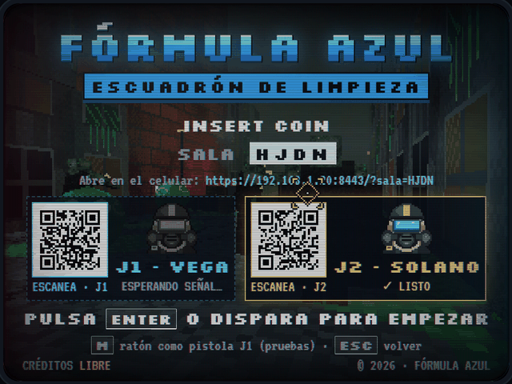

# FÓRMULA AZUL · Guía de instalación y conexión

### Cómo poner en marcha la máquina en tu PC y convertir dos celulares en pistolas ópticas


Esta guía explica, paso a paso, cómo ejecutar el juego, dónde van las dos pistas de música, por qué hace falta HTTPS, cómo dar permiso a los sensores del celular y cómo enlazar el PC con dos celulares en la misma red Wi-Fi.

---

## Índice

0. [Lista rápida](#0-lista-rápida)
1. [Qué necesitas](#1-qué-necesitas)
2. [Archivos del proyecto y dónde va la música](#2-archivos-del-proyecto-y-dónde-va-la-música)
3. [Por qué hace falta HTTPS](#3-por-qué-hace-falta-https)
4. [Opción A · Publicarlo en GitHub Pages (recomendada)](#4-opción-a--publicarlo-en-github-pages-recomendada)
5. [Opción B · Servidor HTTPS local en tu PC](#5-opción-b--servidor-https-local-en-tu-pc)
6. [Opción C · Túnel HTTPS con cloudflared](#6-opción-c--túnel-https-con-cloudflared)
7. [Averiguar la IP de tu PC](#7-averiguar-la-ip-de-tu-pc)
8. [Encender la máquina en el PC](#8-encender-la-máquina-en-el-pc)
9. [Enlazar los celulares](#9-enlazar-los-celulares)
10. [Probar sin celulares: modo ratón](#10-probar-sin-celulares-modo-ratón)
11. [Solución de problemas](#11-solución-de-problemas)
12. [Cómo funciona la conexión](#12-cómo-funciona-la-conexión)

---

## 0. Lista rápida

Si ya sabes lo que haces, esto es todo:

- [ ] Los dos MP3 están en `audio/introgame.mp3` y `audio/level1track.mp3` (nombres exactos, en minúsculas).
- [ ] El juego se abre por **HTTPS** (GitHub Pages, servidor local con certificado o túnel). Con `file://` no se pueden conectar los celulares.
- [ ] El PC y los dos celulares están en la **misma red Wi-Fi** y esa red tiene **internet**.
- [ ] En el PC: abrir la dirección del juego (con la IP, nunca `localhost`) → **ENCENDER MÁQUINA** → **PANTALLA ARCADE**.
- [ ] En cada celular: escanear su QR (J1 o J2) → **CONECTAR Y ACTIVAR SENSORES** → aceptar el permiso de movimiento → apuntar al centro del monitor → **◎ CALIBRAR CENTRO**.
- [ ] Pulsar **ENTER** en el PC o disparar desde un celular.

---

## 1. Qué necesitas

### El PC (la máquina arcade)

| | Requisito |
|---|---|
| **Navegador** | Chrome o Edge 108 o superior (recomendado), Firefox 128 o superior, o Safari 16.4 o superior |
| **Gráficos** | WebGL activado (cualquier tarjeta integrada de los últimos años sirve). Si no hay WebGL, la máquina abre el **Campo de Tiro 2D** de emergencia. |
| **Pantalla** | Un monitor o televisor. La imagen es 4:3, como un tubo arcade, y queda centrada. |
| **Sonido** | Altavoces o auriculares |

### Los celulares (las pistolas)

| | Requisito |
|---|---|
| **Android** | Chrome (recomendado). Necesita giroscopio; casi todos los celulares lo tienen. |
| **iPhone** | Safari en iOS 15.4 o superior (16.4 o superior para que la pantalla no se apague sola). **El iPhone no vibra:** Safari no permite la vibración desde páginas web. |
| **Cuántos** | 1 o 2. El J2 puede unirse con la partida empezada. |

### La red

- PC y celulares en la **misma red Wi-Fi**: así la latencia es mínima.
- Esa red necesita **internet**. El enlace entre los celulares y el PC se negocia con el servidor público de PeerJS, y las librerías (Three.js, PeerJS, generador de QR) y las tipografías se descargan de sus CDN.
- Si no hay Wi-Fi o la red bloquea la comunicación entre dispositivos (pasa en redes de universidad, oficina u hotel), usa el **punto de acceso de un celular con datos**: da internet y red local a la vez. Ver [Solución de problemas](#11-solución-de-problemas).

---

## 2. Archivos del proyecto y dónde va la música

```
formula-azul/
├── index.html                      ← la página del juego (PC y celular usan la misma)
├── style.css                       ← todos los estilos
├── script.js                       ← toda la lógica (un módulo ES)
├── MANUAL_DEL_JUEGO.md
├── GUIA_INSTALACION_Y_CONEXION.md
├── audio/
│   ├── introgame.mp3               ← menú, sala, intro y resultados (en bucle)
│   └── level1track.mp3             ← Nivel 1 y Boss (en bucle)
└── img/
    ├── ... texturas, retratos, miras, iconos y efectos del juego
    └── manual/                     ← capturas usadas por los documentos
```

### Colocar las pistas de música

1. Entra en la carpeta `formula-azul/audio/`. Si no existe, créala junto a `index.html`.
2. Copia ahí las dos pistas con **estos nombres exactos**, en minúsculas y con extensión `.mp3`:
   - `introgame.mp3`
   - `level1track.mp3`
3. Comprueba que Windows no las haya dejado como `introgame.mp3.mp3`. En el Explorador activa **Vista → Mostrar → Extensiones de nombre de archivo** para verlo.

> **Mayúsculas y minúsculas importan.** En Windows `IntroGame.MP3` puede funcionar en local, pero en GitHub Pages y en servidores Linux no se encontrará. Usa siempre los nombres en minúsculas.

### Cambiar la música

Puedes poner otras canciones siempre que sean **MP3** y conserven esos dos nombres. Las dos suenan en bucle, así que conviene que el final enlace bien con el principio. Con 128 a 192 kbps la calidad es buena y la carga rápida.

### Comprobar que el servidor las encuentra

Con el juego ya servido (secciones 4 a 6), abre en el navegador la dirección del juego seguida de `audio/introgame.mp3`, por ejemplo `https://192.168.1.20:8443/audio/introgame.mp3`. Si suena, está bien colocada.

---

## 3. Por qué hace falta HTTPS

Los navegadores solo entregan el **giroscopio** y el **acelerómetro** a páginas abiertas en un **contexto seguro**: `https://`, o `http://localhost` en el propio dispositivo. Un celular que abre `http://192.168.1.20` **no** está en contexto seguro, así que el navegador le niega los sensores y la pistola no puede apuntar.

Abrir `index.html` con doble clic (`file://`) tampoco sirve para jugar con celulares: los celulares no pueden llegar a ese archivo y PeerJS no funciona así. La máquina lo detecta y avisa con **«Sirve el juego por HTTPS para conectar los celulares»**.

Hay tres formas de servirlo por HTTPS. Elige una:

| Opción | Dificultad | Cuándo usarla |
|---|---|---|
| **A · GitHub Pages** | Fácil | Lo más cómodo: HTTPS gratis y sin certificados. Recomendada. |
| **B · Servidor local con certificado** | Media | Si quieres jugar desde tu propio PC sin publicar nada |
| **C · Túnel cloudflared** | Fácil | Para probar rápido sin instalar certificados en los celulares |

---

## 4. Opción A · Publicarlo en GitHub Pages (recomendada)

GitHub Pages sirve el juego por HTTPS con un certificado válido, así que los celulares no muestran avisos ni hace falta instalar nada en ellos.

1. Crea una cuenta en <https://github.com> si no tienes.
2. Pulsa **New repository**. Ponle un nombre, por ejemplo `formula-azul`, déjalo en **Public** y pulsa **Create repository**.
3. En el repositorio vacío, pulsa **uploading an existing file** (o **Add file → Upload files**).
4. Arrastra **el contenido** de la carpeta `formula-azul` (no la carpeta en sí): `index.html`, `style.css`, `script.js`, los dos `.md` y las carpetas `audio` e `img`. Espera a que suban todos los archivos y pulsa **Commit changes**.
5. Ve a **Settings → Pages**. En **Build and deployment**, elige **Source: Deploy from a branch**, rama **main** y carpeta **/ (root)**. Pulsa **Save**.
6. Espera uno o dos minutos y recarga la página de ajustes: aparecerá la dirección del juego, del tipo `https://tu-usuario.github.io/formula-azul/`.
7. Abre esa dirección en el PC y sigue en la [sección 8](#8-encender-la-máquina-en-el-pc).

El QR que muestra la máquina usa la misma dirección con la que abriste el juego, así que los celulares irán directamente a tu página de GitHub Pages.

> **Para actualizar el juego:** sube de nuevo los archivos que cambiaste con **Add file → Upload files**. Los cambios tardan uno o dos minutos en publicarse; si el navegador muestra la versión vieja, recarga con **Ctrl + F5**.

> El repositorio público puede verlo cualquiera que tenga el enlace.

---

## 5. Opción B · Servidor HTTPS local en tu PC

Aquí tu PC sirve el juego a la red Wi-Fi con un certificado propio creado con **mkcert**. Los ejemplos usan la IP `192.168.1.20`: cámbiala por la de tu PC ([sección 7](#7-averiguar-la-ip-de-tu-pc)).

### 5.1 Instalar Node.js

Descarga la versión **LTS** de <https://nodejs.org> e instálala. Comprueba en una terminal (en Windows, **PowerShell**):

```bash
node -v
npx -v
```

### 5.2 Instalar mkcert

| Sistema | Comando |
|---|---|
| Windows | `winget install FiloSottile.mkcert` (o `choco install mkcert`) |
| macOS | `brew install mkcert nss` |
| Linux (Debian / Ubuntu) | `sudo apt install mkcert libnss3-tools` |

Luego crea la autoridad de certificación local y regístrala en el PC (solo hace falta una vez):

```bash
mkcert -install
```

### 5.3 Crear el certificado para tu IP

Crea una carpeta `certs` **fuera** de `formula-azul`, junto a ella, para no subir nunca los certificados con el juego:

```
Escritorio/
├── formula-azul/
└── certs/
```

```bash
cd Escritorio
mkdir certs
cd certs
mkcert 192.168.1.20 localhost 127.0.0.1
```

Se crean dos archivos: `192.168.1.20+2.pem` (certificado) y `192.168.1.20+2-key.pem` (clave).

> **Si la IP de tu PC cambia**, el certificado deja de valer para la nueva dirección: repite este paso con la IP nueva. Para evitarlo, reserva una IP fija para tu PC en el router.

### 5.4 Arrancar el servidor

Desde la carpeta `certs`:

```bash
npx http-server ../formula-azul -S -C 192.168.1.20+2.pem -K 192.168.1.20+2-key.pem -p 8443 -c-1
```

| Parámetro | Significado |
|---|---|
| `-S` | Sirve por HTTPS |
| `-C` / `-K` | Certificado y clave creados por mkcert |
| `-p 8443` | Puerto |
| `-c-1` | Sin caché, para que los cambios se vean al recargar |

La primera vez `npx` pregunta si instalar `http-server`: responde `y`. Deja esa terminal abierta mientras juegas; se detiene con **Ctrl + C**.

En el PC, abre `https://192.168.1.20:8443/` y comprueba que carga sin avisos.

### 5.5 Abrir el puerto en el cortafuegos

- **Windows:** la primera vez que arranca el servidor aparece **«Firewall de Windows Defender bloqueó algunas características»**. Marca **Redes privadas** y pulsa **Permitir acceso**. Si no aparece, abre PowerShell como administrador y ejecuta:

  ```powershell
  netsh advfirewall firewall add rule name="Formula Azul 8443" dir=in action=allow protocol=TCP localport=8443 profile=private
  ```

  Comprueba también que tu Wi-Fi esté marcada como **red privada** en **Configuración → Red e Internet → Wi-Fi → (tu red)**.
- **macOS:** si el sistema pregunta si `node` puede aceptar conexiones entrantes, pulsa **Permitir**.
- **Linux con ufw:** `sudo ufw allow 8443/tcp`

### 5.6 Hacer que los celulares confíen en el certificado

Los celulares no conocen tu autoridad de certificación, así que hay que instalarla en cada uno. Busca dónde está:

```bash
mkcert -CAROOT
```

En esa carpeta está **`rootCA.pem`**. Envíalo a cada celular (por cable, correo, Drive o AirDrop).

> **Nunca compartas `rootCA-key.pem`**, el otro archivo de esa carpeta. Con él cualquiera podría crear certificados en los que tus dispositivos confiarían.

**Android** (los nombres de los menús cambian un poco según la marca):

1. Si el archivo no se reconoce, cámbiale el nombre a `rootCA.crt`.
2. Ve a **Ajustes → Seguridad y privacidad → Más ajustes de seguridad → Cifrado y credenciales → Instalar un certificado → Certificado de CA**. También puedes escribir «certificado» en el buscador de Ajustes.
3. Acepta el aviso, elige el archivo y confirma con tu PIN o huella.

**iPhone:**

1. Abre `rootCA.pem` en el iPhone (con AirDrop o desde el correo). Aparece **«Perfil descargado»**.
2. Ve a **Ajustes → General → VPN y gestión de dispositivos**, toca el perfil de mkcert y pulsa **Instalar**.
3. Ve a **Ajustes → General → Información → Ajustes de confianza de certificados** y activa el interruptor del certificado de mkcert.

Abre `https://192.168.1.20:8443/` en el celular: debe cargar sin avisos de seguridad.

> **Atajo sin instalar el certificado:** en el celular puedes aceptar el aviso del navegador (en Chrome, **Configuración avanzada → Acceder a 192.168.1.20 (sitio no seguro)**). Sirve para algunas pruebas, pero algunos navegadores no tratan esa página como segura. Si el mando muestra **«Sin HTTPS el celular no entrega el giroscopio»**, instala el certificado.

### 5.7 Atajo solo para Android: sin certificados

Chrome para Android permite marcar una dirección `http://` como segura:

1. En el PC, sirve el juego sin HTTPS: `npx http-server ./formula-azul -p 8080 -c-1`
2. En cada celular Android, abre `chrome://flags/#unsafely-treat-insecure-origin-as-secure`.
3. Escribe `http://192.168.1.20:8080`, cambia la opción a **Enabled** y pulsa **Relaunch**.
4. En el PC abre `http://192.168.1.20:8080/`. El PC no necesita sensores, así que puede usar `http://`.

En iPhone no existe esta opción.

---

## 6. Opción C · Túnel HTTPS con cloudflared

Un túnel publica tu servidor local con una dirección `https://` temporal y un certificado válido, sin tocar los celulares.

1. Instala cloudflared:
   - Windows: `winget install --id Cloudflare.cloudflared`
   - macOS: `brew install cloudflared`
   - Linux: descárgalo de la página de Cloudflare Tunnel (paquete `.deb` o `.rpm`).
2. Sirve el juego en local: `npx http-server ./formula-azul -p 8080 -c-1`
3. En otra terminal: `cloudflared tunnel --url http://localhost:8080`
4. cloudflared muestra una dirección del tipo `https://palabras-al-azar.trycloudflare.com`. **Ábrela en el PC** (no `localhost`) para que el QR apunte al túnel.

La página y los archivos viajan por el túnel, pero las órdenes de las pistolas van directas del celular al PC por WebRTC, así que el túnel no añade retraso al apuntar. La dirección cambia cada vez que arrancas el túnel.

---

## 7. Averiguar la IP de tu PC

Es la dirección del PC dentro de tu Wi-Fi. Suele empezar por `192.168.` o `10.`.

| Sistema | Cómo verla |
|---|---|
| Windows | En PowerShell, `ipconfig`. Busca **Dirección IPv4** en el apartado del adaptador **Wi-Fi** (o **Ethernet** si el PC va por cable al mismo router). |
| macOS | `ipconfig getifaddr en0` (si no responde, prueba `en1`), o **Ajustes del Sistema → Wi-Fi → Detalles** |
| Linux | `hostname -I` (la primera dirección) |

---

## 8. Encender la máquina en el PC

1. Abre el juego **con la IP o la dirección pública**, nunca con `localhost`: `https://192.168.1.20:8443/`, tu dirección de GitHub Pages o la del túnel. Si abres `localhost`, la máquina avisa **«Abre el juego con la IP de tu PC para que el QR funcione»**, porque el QR llevaría a los celulares a `localhost`, que para ellos es el propio celular.
2. Pulsa **ENCENDER MÁQUINA** (o ENTER). Ese clic es lo que permite al navegador reproducir la música. Lee el aviso de fotosensibilidad.
3. En el menú elige **PANTALLA ARCADE**.
4. Aparece la sala con:
   - el **código de sala** de 4 caracteres,
   - un **QR para el J1** (cian) y otro **para el J2** (ámbar),
   - la dirección escrita, por si el QR no se puede leer,
   - el estado de cada puesto.
5. Pulsa **F** para pantalla completa.



La sala sigue abierta mientras no salgas al menú. Si recargas la página del PC se crea una sala nueva con otro código y hay que volver a enlazar los celulares.

---

## 9. Enlazar los celulares

### 9.1 Con el QR (lo normal)

1. **Desactiva la rotación automática** del celular: el mando se usa en vertical.
2. Abre la cámara y escanea **tu QR**: J1 el de la izquierda, J2 el de la derecha. Se abre la página del mando con la sala y el jugador ya puestos.
3. Sujeta el celular con las dos manos, pantalla hacia arriba y el borde superior apuntando al monitor.
4. Pulsa **CONECTAR Y ACTIVAR SENSORES**.
   - En **iPhone** aparece **«…quiere acceder al movimiento y la orientación»**: pulsa **Permitir**.
   - En **Android** no se pide nada.
5. El celular vibra dos veces y pasa al **panel trasero del arma**. Arriba pone **SALA XXXX · NNMS** (la latencia). En el PC, su puesto pasa a **CONECTADO · CALIBRA**.
6. **Calibra:** apunta al centro del monitor y toca **◎ CALIBRAR CENTRO**. El celular vibra para confirmar, la mira aparece en el centro y el puesto del PC pasa a **LISTO**.
7. El segundo jugador repite los pasos con el otro QR.
8. Pulsa **ENTER** en el PC o **dispara** desde cualquier celular para empezar.

<p>


</p>

### 9.2 Ajustar la sensibilidad

Mantén pulsado **◎ CALIBRAR CENTRO** durante más de medio segundo y se abre el diálogo de calibración. Ahí eliges el **ángulo máximo**, entre 15° y 45° (por defecto 30°): es cuánto hay que girar el celular desde el centro para llegar al borde de la pantalla.

- **Menos grados:** la mira va más rápida y basta con mover las muñecas.
- **Más grados:** hay que mover más los brazos, pero se apunta con más precisión.

El celular recuerda la sala, el jugador y el ángulo para la próxima vez.

### 9.3 Sin QR: escribir el código

1. En el celular, abre la misma dirección del juego (por ejemplo `https://192.168.1.20:8443/`).
2. Pulsa **ENCENDER MÁQUINA** y elige **MANDO PISTOLA**.
3. Escribe el **código de sala** que muestra el PC, elige **J1 · VEGA** o **J2 · SOLANO** y pulsa **CONECTAR Y ACTIVAR SENSORES**.

También puedes escribir directamente la dirección del QR: `https://192.168.1.20:8443/?sala=K7QX&j=2`.

### 9.4 Durante la partida

- La pantalla del celular se mantiene encendida mientras el mando está abierto (en iPhone, desde iOS 16.4).
- Si el celular pierde la señal, su panel muestra **RECONECTANDO…** y se vuelve a enlazar solo cada 2 segundos. El PC muestra **SEÑAL PERDIDA** en el panel de ese soldado. Si se desconectan todos, la partida se pausa.
- Si la mira se desvía con el tiempo, vuelve a apuntar al centro y toca **CALIBRAR**.
- No bloquees el celular ni cambies de aplicación: el navegador deja de enviar los sensores.

---

## 10. Probar sin celulares: modo ratón

Para comprobar que el juego funciona en el PC antes de conectar nada:

1. En la sala, pulsa **M**: el ratón pasa a ser la pistola del J1.
2. Pulsa **ENTER** para empezar.
3. **Clic izquierdo** dispara, **clic derecho** lanza una granada y la **rueda** (o **R**) recarga.

**M** también funciona durante la partida, y puedes dejarlo activado en **Ajustes → Ratón como pistola J1**.

---

## 11. Solución de problemas

### Conexión

| Síntoma o mensaje | Causa | Solución |
|---|---|---|
| **«No se pudo cargar PeerJS: revisa la conexión a internet.»** | La librería de red no se pudo descargar | Comprueba que la red tenga internet y que ninguna extensión bloquee `cdn.jsdelivr.net`. Recarga. |
| **«Sin conexión con el servidor de PeerJS: revisa internet.»** u otros avisos del servidor de PeerJS | No hay internet o la red bloquea el servidor de PeerJS | Comprueba el internet. En redes muy restringidas, usa el punto de acceso de un celular. |
| **«No existe esa sala. Revisa el código que muestra el PC.»** | Código mal escrito, o el PC recargó y abrió otra sala | Escanea el QR de nuevo o escribe el código que aparece ahora en el PC. |
| **«El J1 ya tiene un celular conectado. Elige el otro jugador.»** | Dos celulares eligieron el mismo jugador | Uno de los dos debe escanear el otro QR o elegir el otro jugador. |
| El celular no abre la página (se queda cargando) | El cortafuegos del PC bloquea el puerto, o el celular no está en la misma red | Revisa la [sección 5.5](#55-abrir-el-puerto-en-el-cortafuegos) y que el celular esté en tu Wi-Fi, no en datos móviles. |
| Funciona en casa pero no en la universidad, la oficina o un hotel | La red aísla a los dispositivos entre sí | Activa el punto de acceso de un celular con datos y conecta a él el PC y los dos celulares. El celular que comparte la conexión normalmente también puede usarse como mando. |
| **«Abre el juego con la IP de tu PC para que el QR funcione»** | El PC abrió `localhost` | Abre el juego con la IP (`https://192.168.1.20:8443/`). |
| **«Sirve el juego por HTTPS para conectar los celulares»** | El juego se abrió con doble clic (`file://`) | Sírvelo con una de las opciones A, B o C. |
| **«QR no disponible: escribe la dirección y el código en el celular»** | La librería del QR no cargó | Usa el enlace manual ([sección 9.3](#93-sin-qr-escribir-el-código)). |
| **SEÑAL PERDIDA** a cada rato | El celular se bloquea o salta a datos móviles | Mantén el mando en primer plano y desactiva el cambio automático a datos móviles cuando el Wi-Fi es débil. |
| La IP del PC cambió y el certificado ya no vale | El router asignó otra IP | Crea un certificado nuevo con la IP nueva ([sección 5.3](#53-crear-el-certificado-para-tu-ip)) o reserva una IP fija en el router. |

### Sensores y vibración

| Síntoma o mensaje | Causa | Solución |
|---|---|---|
| **«Sin HTTPS el celular no entrega el giroscopio. Abre el juego con https://»** | El celular abrió `http://` o una página con un certificado en el que no confía | Usa HTTPS con un certificado válido o instala el certificado de mkcert ([sección 5.6](#56-hacer-que-los-celulares-confíen-en-el-certificado)). |
| **«Permiso de sensores denegado. Actívalo en los ajustes del navegador.»** | En el iPhone se pulsó **No permitir** | Cierra la pestaña, vuelve a abrir el QR y pulsa **Permitir**. Si no vuelve a preguntar, borra los datos del sitio en **Ajustes → Safari → Avanzado → Datos de sitios web**. En Android: **Chrome → ⋮ → Configuración → Configuración de sitios → Sensores de movimiento → Permitir**. |
| **«El celular no está enviando datos del giroscopio.»** o **SIN GIROSCOPIO** en el panel | El celular no tiene giroscopio, o el modo de ahorro de batería apagó los sensores | Desactiva el ahorro de batería. Si el celular no tiene giroscopio, no puede usarse como pistola: prueba otro o usa el modo ratón. |
| La mira se va hacia un lado poco a poco | Deriva normal del sensor de orientación, que se agrava cerca de imanes o altavoces | Toca **CALIBRAR** apuntando al centro. Aleja el celular de imanes, fundas magnéticas y altavoces. |
| La mira va demasiado rápida o lenta | El ángulo máximo no te va | Mantén pulsado **CALIBRAR** y cambia el ángulo ([sección 9.2](#92-ajustar-la-sensibilidad)). |
| La mira se mueve al revés o en el eje equivocado | El celular giró a horizontal | Desactiva la rotación automática y juega en vertical. Vuelve a calibrar. |
| Al agitar no recarga | La sacudida fue demasiado suave | Agita con un golpe seco hacia delante y atrás con las dos manos. |
| El celular no vibra | iPhone (no es posible), o en Android la vibración está desactivada | En Android revisa el modo silencio o **No molestar**, la vibración del sistema y el ahorro de batería. |

### Imagen y sonido

| Síntoma | Causa | Solución |
|---|---|---|
| No suena la música | El navegador espera un clic, el nombre del archivo está mal o el volumen está bajo | Pulsa **ENCENDER MÁQUINA**. Comprueba los nombres de `audio/` ([sección 2](#2-archivos-del-proyecto-y-dónde-va-la-música)) y el volumen en **Ajustes**. |
| Aparece el **Campo de Tiro** en vez de la ciudad 3D | No hay WebGL o Three.js no se pudo descargar | Comprueba el internet. En Chrome abre `chrome://gpu` y mira si WebGL dice **Hardware accelerated**. Activa **Configuración → Sistema → Usar aceleración gráfica cuando esté disponible** y reinicia el navegador. |
| El juego va a tirones | Equipo justo o aceleración gráfica apagada | En **Ajustes**, desactiva **Aberración cromática HQ** y, si hace falta, el **Filtro CRT**. Cierra otras pestañas y activa la aceleración gráfica. |
| Aviso de certificado en el PC (`NET::ERR_CERT_AUTHORITY_INVALID`) | La autoridad de mkcert no está instalada en el PC | Ejecuta `mkcert -install` y reinicia el navegador. En Firefox para macOS o Linux hace falta `nss`. |
| Los destellos molestan | Es el *flash* de pistola óptica | Activa **Ajustes → Reducir destellos**. |

---

## 12. Cómo funciona la conexión

```
                ┌───────────────────────────────────┐
 INTERNET       │    0.peerjs.com · señalización    │
                └──▲─────────────▲──────────────▲───┘
                   │             │              │ solo al conectar
───────────────────┼─────────────┼──────────────┼── red Wi-Fi
                   │             │              │
              ┌────┴────┐  ┌─────┴──────┐  ┌────┴────┐
              │  CEL J1 ├─►│ PC MÁQUINA │◄─┤  CEL J2 │
              └─────────┘  │ sala K7QX  │  └─────────┘
                           └────────────┘
                mandos ──► PC: WebRTC directo por el Wi-Fi
```

1. El PC se registra en el servidor de PeerJS con el identificador `formula-azul-n1-` seguido del código de sala.
2. El celular pide al servidor de PeerJS conectar con ese identificador.
3. El servidor les ayuda a encontrarse y abren un canal **WebRTC** directo entre los dos. Desde ese momento, las órdenes del mando ya no pasan por el servidor de PeerJS.
4. El celular envía al PC la puntería (dos números entre −1 y 1, en cada lectura del giroscopio que cambia) y las órdenes de disparar, lanzar granada, recargar, calibrar y pausar. El PC devuelve al celular su vida, munición, granadas y el estado de la partida, y le dice cuándo vibrar.
5. Cada 2 segundos el mando mide la latencia (aparece en su panel). Si el canal se corta, el mando lo vuelve a abrir solo.

**Limitación:** el juego necesita internet para el servidor de PeerJS, las librerías y las tipografías. Sin internet, la máquina no puede abrir sala.

**Lo que se guarda:** el PC guarda en su navegador los ajustes y la tabla de récords. Cada celular guarda la última sala, el jugador y el ángulo de calibración. No se envía nada a ningún servidor propio.

---

Para aprender a jugar, consulta **[MANUAL_DEL_JUEGO.md](MANUAL_DEL_JUEGO.md)**.
