# FÓRMULA AZUL · ESCUADRÓN DE LIMPIEZA

### Manual de operaciones y documento de diseño · Nivel 1: Distrito Cero

```
╔══════════════════════════════════════════════════════════════╗
║   FÓRMULA AZUL  ·  ESCUADRÓN DE LIMPIEZA                     ║
║   RAIL SHOOTER 3D · 1-2 JUGADORES COOPERATIVO                ║
║                                                              ║
║   ▸ EL PC ES LA MÁQUINA          ▸ TU CELULAR ES LA PISTOLA  ║
║   ▸ APUNTA MOVIENDO EL CELULAR   ▸ AGITA PARA RECARGAR       ║
║                                                              ║
║            INSERT COIN · CONECTA TUS CELULARES               ║
╚══════════════════════════════════════════════════════════════╝
```

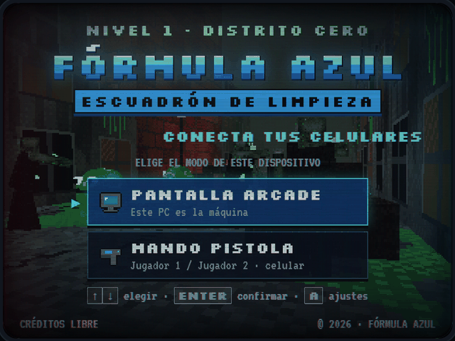

---

## Índice

1. [Ficha del juego](#1-ficha-del-juego)
2. [La historia](#2-la-historia)
3. [Cómo se juega](#3-cómo-se-juega)
4. [Controles](#4-controles)
5. [La pantalla de juego](#5-la-pantalla-de-juego)
6. [El Escuadrón de Limpieza](#6-el-escuadrón-de-limpieza)
7. [Armamento: rifle FA-7 y lanzagranadas LG-40](#7-armamento-rifle-fa-7-y-lanzagranadas-lg-40)
8. [Bestiario](#8-bestiario)
9. [Boss: MADRE BABA](#9-boss-madre-baba)
10. [Objetos](#10-objetos)
11. [El Nivel 1: Distrito Cero](#11-el-nivel-1-distrito-cero)
12. [Puntuación y récords](#12-puntuación-y-récords)
13. [Dirección de arte](#13-dirección-de-arte)
14. [Audio](#14-audio)
15. [Ajustes y accesibilidad](#15-ajustes-y-accesibilidad)
16. [Consejos de veterano](#16-consejos-de-veterano)
17. [Ficha técnica](#17-ficha-técnica)
18. [Créditos](#18-créditos)

---

## 1. Ficha del juego

| | |
|---|---|
| **Título** | FÓRMULA AZUL: Escuadrón de Limpieza |
| **Género** | Rail shooter 3D en primera persona, estilo arcade de pistola óptica |
| **Inspiración** | *The House of the Dead*, *Alien: Armageddon* |
| **Jugadores** | 1 o 2 en cooperativo local (el segundo puede unirse a mitad de partida) |
| **Plataforma** | Navegador web: el PC hace de máquina arcade y cada celular de pistola |
| **Control** | Celular sujetado a dos manos: giroscopio para apuntar, dos gatillos táctiles, agitar para recargar |
| **Contenido del Nivel 1** | 3 tramos, 5 oleadas y un Boss: una partida arcade corta |
| **Estética** | 3D low-poly estilo PlayStation 1 / Nintendo 64, filtro de televisor CRT |
| **Resolución interna** | 320 × 240 píxeles, escalada sin suavizado |

---

## 2. La historia

> **Año 2031.** El reactor experimental **«Génesis»** de la corporación **Verdant Corp.** se fractura en el corazón del **Distrito Cero**. Lo que sale de sus tanques no es vapor ni radiación común: es una **baba verde radiactiva** que se mueve sola, se filtra por las alcantarillas y muta todo lo que toca.

En pocas semanas la baba cubre el planeta. Las ciudades caen una tras otra. Los habitantes del Distrito Cero se convierten en **Zombies Contaminados**: cuerpos rígidos, piel gris verdosa, pústulas que brillan en la oscuridad. La baba misma toma forma y se arrastra por las calles como **Criaturas de Baba Verde** que escupen lodo ácido.

Solo hay una sustancia capaz de revertir la mutación: la **Fórmula Azul**, un compuesto purificador de color neón que desarma la baba al contacto. No hay forma de rociarla sobre una ciudad entera, así que se dispara: en balas, en granadas y en tanques que cada soldado lleva sobre el arma.

Para eso se activa el **Escuadrón de Limpieza**, una unidad de descontaminación de élite que combina armadura militar con equipo NBQ (nuclear, biológico y químico). Su primera misión: entrar al Distrito Cero, abrirse paso por la Avenida y la Calle del Mercado hasta la **Plaza Génesis** y purificar lo que vive bajo el reactor: **MADRE BABA**, el coloso radiactivo del que nace toda la contaminación.

**ORDEN: PURIFICAR.**

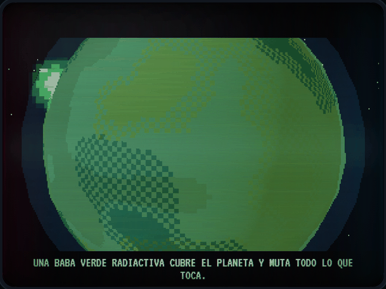

---

## 3. Cómo se juega

### El ciclo de una partida

1. **Encender la máquina.** En el PC se pulsa **ENCENDER MÁQUINA**. Aparece el menú con el *attract mode*: una cámara de seguridad muestra la avenida en ruinas con zombies golpeando un carro, babas, barriles que derraman lodo, fuego y humo, mientras suena el tema principal.
2. **Abrir la sala.** Se elige **PANTALLA ARCADE**. El PC muestra un código de 4 caracteres y un QR para cada jugador.
3. **Conectar los celulares.** Cada jugador escanea su QR, pulsa **CONECTAR Y ACTIVAR SENSORES** y calibra el centro (ver [Controles](#4-controles)).
4. **Empezar.** Con al menos un mando conectado, se pulsa **ENTER** en el PC o se **dispara** desde cualquier celular.
5. **Intro.** Una cinemática cuenta la historia. Se salta disparando o con ENTER.
6. **El riel.** La cámara avanza sola por la ciudad. En cada parada aparece una oleada; la cámara no sigue hasta que la zona queda limpia.
7. **El Boss.** Al final de la Plaza Génesis emerge MADRE BABA.
8. **Resultados.** Se muestra el informe de misión. Si alguien hizo récord, escribe sus iniciales en el teclado del PC (o dispara para guardarlas con las del soldado).

### Reglas básicas

- Cada soldado tiene **5 de vida**, **12 cargas** de Fórmula Azul y **3 granadas**.
- Los enemigos atacan al soldado **del lado de la pantalla en el que están**: lo de la izquierda amenaza a J1 y lo de la derecha a J2. En solitario, todo va contra el único soldado.
- Si un soldado llega a 0 de vida, la partida se pausa y aparece **¿CONTINUAR?** con una cuenta regresiva de **9 segundos**. Disparando desde ese celular (o con ENTER) vuelve con la vida, la munición y las granadas llenas, y conserva sus puntos. Si elige **RENDIRSE** o se acaba la cuenta, queda fuera hasta el final del nivel y su compañero sigue solo.
- Si nadie continúa y no queda ningún soldado en pie: **GAME OVER**.
- **El J2 puede unirse en cualquier momento:** se conecta, dispara una vez y entra a la partida con el equipo completo.
- Si un celular pierde la señal, su panel muestra **SEÑAL PERDIDA** y el mando se reconecta solo. Si no queda ningún mando conectado, la partida se pausa.

---

## 4. Controles

### 4.1 Cómo sujetar el mando

El celular se sujeta **con las dos manos, en vertical, con la pantalla hacia arriba y el borde superior apuntando al monitor**, como si fuera el panel trasero de un rifle. Los pulgares quedan sobre la mitad inferior de la pantalla, uno en cada gatillo.

```
                 ▲ hacia el monitor
   ┌────────────────────────────────┐
   │ ■ SALA K7QX · 23MS   J1 · VEGA │ ← estado del enlace y jugador
   │        ■ MIRA ESTABILIZADA     │ ← se enciende al agitar
   │ FÓRMULA AZUL                   │
   │ [▮▮▮▮▮▮▮▮▮▮▯▯]          10/12  │ ← tanque de munición
   │ GRANADAS           LISTO PARA  │
   │ ● ● ●                DISPARAR  │ ← granadas y estado del arma
   │ [  ◎ CALIBRAR CENTRO  ]  [ II ]│ ← calibrar · pausa
   ├────────────────┬───────────────┤
   │                │               │
   │     LANZA-     │    GATILLO    │
   │   GRANADAS     │       ⊕       │
   │                │               │
   │ pulgar izquierdo│pulgar derecho│
   └────────────────┴───────────────┘
```

<p>
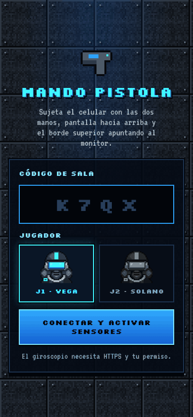
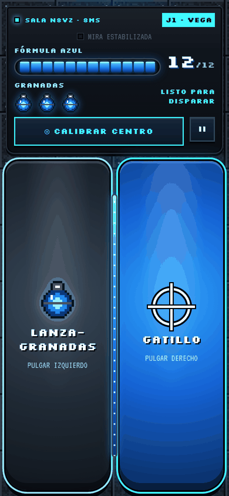
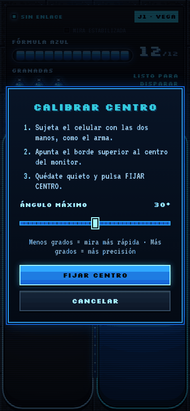
</p>

### 4.2 Acciones del mando

| Acción | Cómo | Qué pasa |
|---|---|---|
| **Apuntar** | Girar y levantar el celular | El giroscopio mueve tu mira en el PC. Girar a la izquierda o a la derecha mueve la mira en horizontal; levantar o bajar la punta la mueve en vertical. |
| **Disparar** | Pulgar derecho en **GATILLO** | Un disparo por toque (semiautomático, hasta unos 11 por segundo). |
| **Granada** | Pulgar izquierdo en **LANZAGRANADAS** | Lanza una Granada Purificadora en parábola hacia tu mira. 0,9 s de espera entre granadas. |
| **Recargar** | **Agitar** el celular con las dos manos | Rellena el tanque en 0,6 s. Durante 250 ms la mira se congela para que la sacudida no la descontrole. |
| **Calibrar centro** | Toque corto en **◎ CALIBRAR CENTRO** | Lo que apuntas en ese momento pasa a ser el centro de la pantalla. |
| **Ajustar sensibilidad** | Mantener pulsado **CALIBRAR** (0,6 s) | Abre el diálogo con el **ángulo máximo** (15° a 45°, por defecto 30°). Menos grados = mira más rápida; más grados = más precisión. |
| **Pausa** | Botón **II** | Pausa o reanuda la partida en el PC. |
| **Empezar / saltar / continuar** | Disparar | En la sala empieza la partida, en la intro la salta, en ¿CONTINUAR? te devuelve a la acción y en resultados vuelve a la sala. |

> **Cómo se calcula la mira:** al calibrar se guardan `baseAlpha` y `baseBeta`. Después, cada eje se normaliza con `clamp((actual - base) / ángulo máximo, -1, 1)`, así que girar 30° desde el centro (con el ajuste por defecto) lleva la mira al borde de la pantalla.

### 4.3 Respuesta háptica (vibración)

| Evento | Patrón (ms) | Sensación |
|---|---|---|
| Disparo | `40 · 15 · 10` | Retroceso seco y corto, como una pistola de arcade |
| Explosión de tu granada | `150 · 40 · 250` | Retumbe largo en las dos manos |
| Recarga | `25 · 120 · 70` | Clic de cargador y golpe de cierre |
| Cargador vacío o acción no disponible | `12` | Toque mínimo |
| Lanzamiento de granada | `22` | Golpe suave del tubo |
| Recibes daño | `90 · 40 · 90` | Doble golpe |
| Botiquín | `20 · 40 · 20 · 40 · 60` | Pulso ascendente |
| Centro calibrado | `30 · 60 · 30` | Confirmación |
| Enlace con la máquina | `50 · 50 · 50` | Saludo |

> En iPhone el navegador no permite vibrar: el retroceso se ve en pantalla (el panel se sacude), pero no se siente.

### 4.4 Teclado y ratón del PC

| Tecla | Dónde | Función |
|---|---|---|
| **ENTER** | Encendido | Enciende la máquina |
| **↑ ↓** o **W S** | Menú | Elige el modo |
| **ENTER** / **ESPACIO** | Menú | Confirma el modo |
| **A** | Menú y sala | Abre los ajustes |
| **ENTER** | Sala | Empieza la partida |
| **ESC** | Sala | Vuelve al menú (cierra la sala) |
| **M** | Sala y partida | Activa o desactiva el **ratón como pistola del J1** |
| **ENTER** / **ESC** | Intro | Salta la cinemática |
| **ESC** o **P** | Partida | Pausa |
| **R** | Partida (modo ratón) | Recarga |
| **F** | En cualquier momento | Pantalla completa |
| **ENTER** | Resultados | Guarda el récord y vuelve a la sala |

**Modo ratón (para pruebas):** clic izquierdo dispara, clic derecho lanza una granada y la rueda recarga.

---

## 5. La pantalla de juego

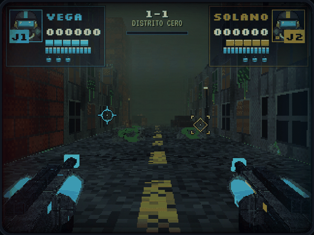

| Elemento | Dónde | Qué indica |
|---|---|---|
| **Retrato del soldado** | Esquinas superiores | Su máscara antirradiación. Se sacude en rojo al recibir daño y el visor aparece **agrietado y ensangrentado** cuando queda 1 de vida. |
| **Etiqueta J1 / J2** | Sobre el retrato | Cian para J1, ámbar para J2 |
| **Puntos** | Junto al retrato | Puntuación de 6 cifras |
| **Vida** | 5 cápsulas del color del jugador | Parpadean en rojo cuando queda 1 |
| **Munición** | 12 cápsulas azules | Cargas de Fórmula Azul en el tanque |
| **Granadas** | 3 iconos | Granadas Purificadoras en el LG-40 |
| **¡AGITA!** | Bajo el panel | Cargador vacío: hay que sacudir el celular |
| **RECARGANDO** | Bajo el panel | El tanque se está llenando |
| **SEÑAL PERDIDA** | Bajo el panel | Ese celular se desconectó |
| **J2 · CONECTA TU CELULAR / DISPARA PARA UNIRTE** | Panel del J2 | El segundo puesto está libre |
| **1-1, 1-2, 1-3** | Arriba al centro | Tramo del nivel y barra de avance del riel |
| **Miras** | Sobre la escena | J1: **círculo cian** · J2: **rombo ámbar** (se distinguen también por la forma) |
| **Rifles en primera persona** | Abajo | El tanque transparente de cada rifle se vacía al disparar y se llena al recargar |
| **Barra del Boss** | Abajo al centro | Vida de MADRE BABA; destella en azul con cada impacto |

### El visor dañado

El daño se ve en el visor de la máscara de cada soldado, sobre su mitad de la pantalla (en solitario, sobre toda):

| Vida | Efecto |
|---|---|
| 5 | Visor limpio |
| 4 y 3 | `damage-lvl-1`: bordes rojos suaves |
| 2 | `damage-lvl-2`: la viñeta se cierra y aparece sangre en los bordes |
| 1 | `damage-critical`: viñeta cerrada que late, sangre y **grietas en el cristal** |

Cada golpe además produce un **destello rojo en los bordes** y una sacudida de cámara. La viñeta solo retrocede cuando te curas **disparándole a un botiquín**.

### El destello óptico

Cada disparo enciende la pantalla del PC de **blanco puro durante exactamente un fotograma**, como el *flash* que usaban las pistolas ópticas de los arcades de los 90 para saber a dónde apuntaban. Si molesta, se reduce en Ajustes (ver [Accesibilidad](#15-ajustes-y-accesibilidad)).

---

## 6. El Escuadrón de Limpieza

Los dos soldados llevan el mismo equipo y se manejan igual; los distingue el color de su franja (en el casco y el hombro) y la forma de su mira.

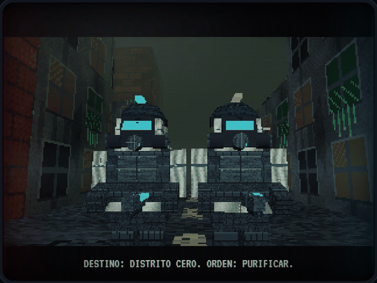

<table>
<tr>
<td width="50%" valign="top">

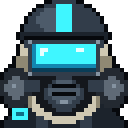

### PURGA-01 «VEGA» · Jugador 1

| | |
|---|---|
| **Rango** | Sargento, tiradora de vanguardia |
| **Color de unidad** | Cian `#3FF6FF` |
| **Mira** |  Círculo con cuatro marcas |
| **Lado de la pantalla** | Izquierdo (en cooperativo) |
| **Perfil** | Mara Vega fue la primera en entrar al perímetro del Génesis tras la fuga. Dice que el zumbido de la baba se oye antes de verla. Prefiere el tiro a la cabeza antes que gastar granadas. |

</td>
<td width="50%" valign="top">

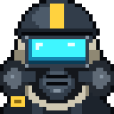

### PURGA-02 «SOLANO» · Jugador 2

| | |
|---|---|
| **Rango** | Cabo, especialista en demolición |
| **Color de unidad** | Ámbar `#FFD23F` |
| **Mira** |  Rombo con esquinas en escuadra |
| **Lado de la pantalla** | Derecho |
| **Perfil** | Iván Solano diseñó la carga de las Granadas Purificadoras. Cree que no hay grupo de zombies que resista una granada bien puesta y lleva la cuenta de los barriles que hace volar. |

</td>
</tr>
</table>

### Ficha técnica del equipo NBQ

| Pieza | Descripción |
|---|---|
| **Máscara antirradiación M-50X** | Máscara de rostro completo de caucho negro. **Visor panorámico iluminado en cian** con lectura del HUD integrada, **dos filtros laterales** de carbón activado y un respirador central con válvula metálica. |
| **Capucha NBQ** | Capa de butilo color hueso que sella cuello y hombros por debajo del casco. |
| **Casco táctico** | Casco balístico gris metálico con una **franja del color de la unidad** sobre la cresta. |
| **Traje de dos capas** | Interior hermético NBQ color hueso con costuras termoselladas; exterior táctico gris carbón con **chaleco modular**, placa pectoral y parche de hombro del color de la unidad. |
| **Guantes tácticos** | Guantes reforzados gris acero sobre guantes de nitrilo. Son lo que se ve sosteniendo el rifle en primera persona. |
| **Botas** | Botas de caucho sellado con suela antideslizante para el lodo. |

<p>
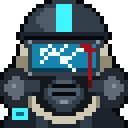
&nbsp;Con 1 de vida el retrato del HUD muestra el visor agrietado y manchado de sangre.
</p>

---

## 7. Armamento: rifle FA-7 y lanzagranadas LG-40

```
             riel superior                  franja del jugador
          ┌───────────────────────────────────────────────┐
 boca ════╡ ░░░░░ TANQUE DE FÓRMULA AZUL ░░░░░    ▓▓▓▓▓▓▓▓ ╞══════════╗
 azul     └───────┬─────────────────────────────┬─────────┘          ║
          ════════╧════ (o) ════════════════════╛     ██             ║ culata
          LG-40: tubo con la granada a la vista       empuñadura ════╝
```

### Rifle FA-7 «Purificador» (cañón principal)

| | |
|---|---|
| **Capacidad** | 12 cargas de Fórmula Azul |
| **Cadencia** | Semiautomática: un disparo por toque, con 90 ms mínimos entre disparos (≈ 11 por segundo) |
| **Recarga** | Agitar el arma: 0,6 s |
| **Traza** | Bala con traza azul eléctrica y destello azul en la boca |
| **Indicador** | **Dos tanques transparentes** a los lados del cajón: el líquido azul baja con cada disparo y sube al recargar |
| **Daño** | 1 por impacto (2 en la cabeza de un zombie) |
| **Alcance** | 70 m; las paredes y los carros detienen la bala |

### Lanzagranadas acoplado LG-40 (cañón inferior)

| | |
|---|---|
| **Capacidad** | 3 Granadas Purificadoras (se ve la siguiente granada dentro del tubo) |
| **Disparo** | Parábola desde el cañón inferior hasta el punto de la mira; alcance máximo 30 m |
| **Explosión** | Estallido azul de **4,5 m de radio** que hace **3 de daño** a todo lo que alcance y deja una nube de partículas azules |
| **Contra el Boss** | Daño doble (6) |
| **Extras** | Destruye los escupitajos y detona los barriles tóxicos dentro del radio |
| **Espera** | 0,9 s entre granadas |
| **Recarga** | No se recarga agitando: se recuperan con las **cajas de granadas** |

<p>

&nbsp;Granada Purificadora en vuelo.
</p>

---

## 8. Bestiario

Todo enemigo **brilla en azul eléctrico durante 100 ms** cuando recibe un impacto y, al morir, se tiñe de azul y **se disuelve en partículas azules** que suben. En cooperativo los enemigos son más resistentes y cada parada trae uno extra.

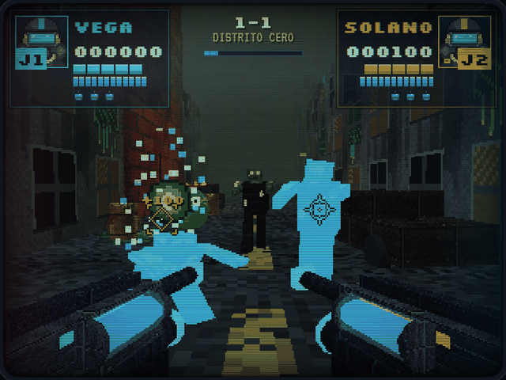

### Zombie Contaminado

| | |
|---|---|
| **Qué es** | Habitante del Distrito Cero mutado por la baba. Piel gris verdosa, ojos y pústulas que brillan en verde. |
| **Vida** | 3 (4 en cooperativo) |
| **Punto débil** | **La cabeza:** recibe 2 de daño por disparo. Matarlo con un tiro a la cabeza da +50 puntos. |
| **Comportamiento** | Emerge del suelo en 0,9 s, camina hacia el escuadrón (de 0,95 a 1,4 m/s) y se planta a 1,75 m para golpear. |
| **Ataque** | Un golpe cada 1,6 s: **−1 de vida** al soldado de su lado de la pantalla. |
| **Puntos** | 100 |
| **Otros** | Puede soltar un botiquín al morir (8 % de probabilidad, dura 9 s). |

### Criatura de Baba Verde

| | |
|---|---|
| **Qué es** | Baba radiactiva con forma propia: un bulto que salta, con dos ojos y una boca. |
| **Vida** | 2 (3 en cooperativo) |
| **Comportamiento** | Salta hasta quedar entre 7,5 y 11 m del escuadrón. Cada 2,6 a 3,8 s **se infla durante 0,55 s** (ese es el aviso) y escupe. A veces cambia de sitio. |
| **Ataque** | Escupitajo de baba (ver abajo). |
| **Puntos** | 150 |

### Escupitajo de baba

<p></p>

| | |
|---|---|
| **Qué es** | Proyectil verde que vuela directo hacia un soldado a 6,4 m/s. |
| **Destructible** | **Sí:** un disparo lo revienta (+20 puntos). |
| **Si llega** | **−1 de vida** y una mancha verde en la pantalla. |

---

## 9. Boss: MADRE BABA

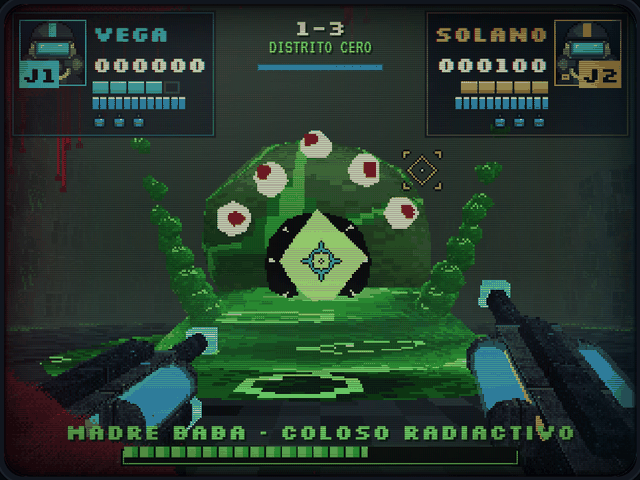

> **MADRE BABA · COLOSO RADIACTIVO.** La masa original que salió del reactor Génesis. Anida bajo la Plaza Génesis, en un enorme charco de lodo radiactivo. Tiene cinco ojos de pupila roja, una boca redonda llena de dientes, cuatro tentáculos y, en el centro, un **núcleo de cristal verde** que late con la contaminación de todo el planeta.

| | |
|---|---|
| **Vida** | 150 (240 en cooperativo) |
| **Aparición** | Emerge del charco en 3,6 s mientras la pantalla muestra **⚠ WARNING ⚠ · ALERTA BIOLÓGICA CLASE OMEGA** |
| **Fase 2** | Por debajo del 50 % de vida: **¡MADRE BABA ENFURECE!** Ataca más rápido y escupe más. |

### Puntos débiles

| Zona | Daño por disparo | Puntos |
|---|---|---|
| Cuerpo y tentáculos | 1 | 10 |
| **Ojos** (5) | 2 · cada ojo revienta tras 3 impactos | 10 + **250** al reventarlo |
| **Núcleo** | **3** (**6** cuando está abierto) | 30 |
| Granada | 6 | 10 |
| **Derrotarla** | — | **5000** para quien dé el golpe final |

### Ataques

| Ataque | Aviso | Qué hace | Cómo contrarrestarlo |
|---|---|---|---|
| **Ráfaga de escupitajos** | El cuerpo se infla (0,75 s; 0,5 s en fase 2) | Dispara 3 escupitajos seguidos (5 en fase 2), alternando entre los dos soldados | Derríbalos antes de que lleguen: valen 20 puntos cada uno |
| **Invocación** | Dos bultos de baba brotan del charco, delante de ella | Hace emerger 2 Criaturas de Baba (solo invoca si quedan menos de 3 en pie) | Elimínalas rápido: también escupen |
| **Golpe de tentáculos** | Levanta los cuatro tentáculos y **abre el núcleo** (1,6 s; 1,2 s en fase 2) | Golpea el suelo: una **onda de choque verde** barre la plaza y quita **−1 de vida a todos** | **Castiga el núcleo abierto:** si le hacéis 12 de daño por jugador mientras levanta los tentáculos, **se aturde 2,2 s** con el núcleo expuesto y el golpe se cancela |

Al morir, MADRE BABA se ilumina de azul, estalla en ráfagas de Fórmula Azul y se hunde en su charco. Las babas que hubiera invocado se disuelven con ella.

---

## 10. Objetos

Los objetos flotan sobre la escena. **Se recogen disparándoles**, como en los arcades clásicos.

| Objeto | Efecto | Puntos |
|---|---|---|
|  **Botiquín** | **+1 de vida** a quien le dispara (máximo 5). La viñeta del visor se aclara y suena un pulso ascendente. | 50 |
|  **Caja de granadas** | **+1 granada** (máximo 3) | 50 |
| **Barril tóxico explosivo** | Barril amarillo con el trébol radiactivo. **Dos disparos** y revienta en un estallido verde de 3,8 m que hace 3 de daño. Puede encadenar otros barriles. | 50 |

El botiquín es blanco con una **cruz azul de Fórmula Azul**. No usa la cruz roja, que es un emblema protegido.

---

## 11. El Nivel 1: Distrito Cero

```
                  1-2 · CALLE DEL MERCADO                1-3 · PLAZA GÉNESIS
     ████████████████████████████████████████████████   ████████████████████
     ███ ╔═══►════[M1]═══════════════[M2]══════════════════►[JEFE]  MADRE  ██
     ███ ║ ██████████████████████████████████████████   ██          BABA   ██
       █ ║ █                                            ████████████████████
       █[A3]█  ← 4 zombies + 1 baba · caja de granadas
       █ ║ █
       █[A2]█  ← 3 zombies + 1 baba
       █ ║ █
       █[A1]█  ← 3 zombies · botiquín sobre un carro
       █ ║ █
       █ ▲ █   INICIO
     1-1 · AVENIDA
```

La cámara avanza por un riel a 3,6 m/s, con el balanceo de quien camina. Tras el aviso **NIVEL 1 · DISTRITO CERO · ¡PURIFICAD LA CIUDAD!** arranca la marcha. En cada parada la cámara gira hacia la zona de peligro y no sigue hasta que la oleada cae.

| Tramo | Parada | Enemigos (solitario) | Extra en cooperativo | Objetos |
|---|---|---|---|---|
| **1-1 Avenida** | A1 | 3 zombies | +1 zombie | Botiquín sobre el capó de un carro |
| | A2 | 3 zombies + 1 baba | +1 baba | — |
| | A3 (antes del giro) | 4 zombies + 1 baba | +1 zombie | Caja de granadas |
| **1-2 Calle del Mercado** | M1 | 2 babas + 2 zombies | +1 zombie | Botiquín |
| | M2 | 4 zombies + 1 baba | +1 baba | Caja de granadas y botiquín |
| **1-3 Plaza Génesis** | Jefe | MADRE BABA | Más vida | — |

**Escenario:** edificios low-poly en ruinas con ventanas rotas y lodo que chorrea, carros oxidados (algunos en llamas, con humo), barriles tóxicos derramando baba, farolas que parpadean, barreras de concreto y cuatro **barriles explosivos** estratégicos, uno cerca de cada grupo de enemigos.

Total del nivel en solitario: 16 zombies, 5 babas y el Boss.

---

## 12. Puntuación y récords

| Acción | Puntos |
|---|---|
| Zombie purificado | 100 |
| Bonus por tiro a la cabeza (golpe final) | +50 |
| Criatura de Baba purificada | 150 |
| Escupitajo derribado | 20 |
| Barril explosivo | 50 |
| Botiquín o caja de granadas | 50 |
| Impacto al Boss (cuerpo) | 10 |
| Impacto al núcleo del Boss | 30 |
| Ojo del Boss reventado | 250 |
| **MADRE BABA derrotada** | **5000** |

El **informe de misión** muestra, por soldado: puntos, enemigos purificados, precisión (impactos / disparos), granadas usadas y botiquines recogidos.

La tabla de **récords** guarda los 5 mejores puntajes con 3 iniciales. Aparece en el *attract mode* cada pocos segundos. Se guarda en el navegador del PC.

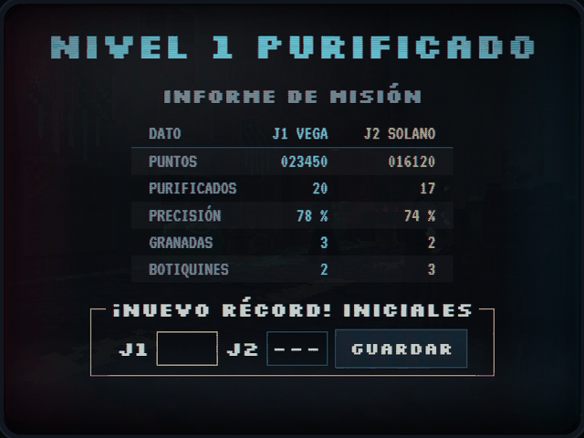

---

## 13. Dirección de arte

### Pipeline PS1 / N64

| Técnica | Cómo se logra |
|---|---|
| **Baja resolución** | Three.js renderiza a 320 × 240 y CSS escala con `image-rendering: pixelated` |
| **Texturas sin filtrar** | `THREE.NearestFilter` sin mipmaps; texturas de 64 × 64 con *dithering* ordenado |
| **Temblor poligonal** | *Vertex snapping* en el shader: cada vértice se redondea a una rejilla de 160 × 120 tras proyectarse |
| **Niebla N64** | `THREE.Fog` verde grisáceo `#2B3B2F` de 7 a 46 m |
| **Iluminación** | Materiales Lambert, luz hemisférica, luna y luces de fuego que titilan |
| **Partículas** | Cuadrados sin textura, como en las consolas de 32 bits |

### Filtro CRT

Scanlines (una por cada una de las 240 filas), máscara de apertura RGB, aberración cromática en los bordes y en el texto, barra de barrido, vidrio curvo con viñeta y reflejo, y animación de encendido del tubo. Opcional: aberración cromática real (filtro SVG) sobre el render 3D.

### Paleta

| Color | Hex | Uso |
|---|---|---|
| Fórmula Azul | `#1462D4` · `#2FA8FF` · `#7FE8FF` | Arma, balas, granadas, impactos, disolución de enemigos |
| Cian J1 / visores | `#3FF6FF` | Jugador 1 y visores de las máscaras |
| Ámbar J2 | `#FFD23F` | Jugador 2 |
| Baba radiactiva | `#41D23F` · `#8CFF5C` | Enemigos, lodo, Boss |
| Sangre / daño | `#C4161F` | Viñeta del visor y alertas |
| Noche | `#02050A` | Fondo de la interfaz |

**Tipografía:** Silkscreen (títulos e interfaz arcade, con los acentos del español bien dibujados) y VT323 (textos de terminal).

**Regla de construcción:** la interfaz no tiene ni un estilo en línea. Cada cambio visual (vistas, destellos, viñeta de daño, recarga) es una clase CSS. Por eso las miras se dibujan en un lienzo propio y no como elementos que haya que mover.

---

## 14. Audio

| Pista | Archivo | Cuándo suena |
|---|---|---|
| Tema principal | `audio/introgame.mp3` | Menú, sala, intro y resultados (en bucle) |
| Tema del nivel | `audio/level1track.mp3` | Desde el inicio del riel hasta el final del Boss (en bucle) |

El cambio entre pistas es un **fundido cruzado de 1,2 s**. En pausa la música baja al 35 %.

**Efectos de sonido:** todos se sintetizan en vivo con la Web Audio API (no hay archivos): disparo, cargador vacío, recarga, lanzamiento y explosión de granada, golpe recibido, curación, purificación, gemido de zombie, escupitajo, salpicadura, emerger, rugido y golpe del Boss, recoger objetos, alarma de alerta biológica, moneda, navegación del menú, conexión y desconexión de mandos, encendido del tubo y la cuenta del continue. Cada efecto suena **hacia el lado de la pantalla** donde ocurre.

---

## 15. Ajustes y accesibilidad

Se abren con **A** en el menú y la sala, o desde **PAUSA → AJUSTES**. Se guardan en el navegador del PC.

| Ajuste | Por defecto | Efecto |
|---|---|---|
| Música | 80 | Volumen de las pistas |
| Efectos | 90 | Volumen de los efectos |
| Filtro CRT | Activado | Scanlines, curvatura y aberración |
| Aberración cromática HQ | Desactivado | Separación RGB real sobre el 3D (pide más al PC) |
| Temblor poligonal PS1 | Activado | *Vertex snapping* |
| Reducir destellos | Desactivado | Baja el destello de cada disparo al 18 % |
| Ratón como pistola J1 | Desactivado | Para probar sin celular |

> **⚠ Fotosensibilidad.** Cada disparo produce un destello blanco de pantalla completa. La pantalla de encendido lo advierte. Si eres sensible a las luces intermitentes, activa **Reducir destellos**. Si tu sistema tiene activada la opción de reducir movimiento, el juego baja el destello y quita animaciones por su cuenta.

Otras ayudas: las miras se distinguen por forma además de por color, los paneles anuncian su estado con texto («¡AGITA!», «RECARGANDO», «SEÑAL PERDIDA») y el mando mantiene la pantalla encendida mientras juegas.

---

## 16. Consejos de veterano

- **Calibra con el cuerpo en tu postura de juego.** Siéntate o párate como vas a jugar, apunta al centro del monitor y toca CALIBRAR. Si la mira se va de lado con el tiempo, vuelve a tocarlo: toma medio segundo.
- **Apunta a la cabeza.** Un zombie cae con 2 disparos a la cabeza en vez de 3 al cuerpo, y da 50 puntos extra.
- **Primero los escupitajos.** Son lentos, valen 20 puntos y cada uno que llega te cuesta 1 de vida.
- **Las babas avisan.** Cuando una se infla, tienes medio segundo: mátala o prepárate para derribar lo que escupa.
- **Agita sin miedo.** La mira se congela 250 ms durante la sacudida, así que al terminar sigue donde la dejaste.
- **Guarda las granadas para los grupos**, o para el Boss, donde hacen el doble de daño.
- **Los barriles son granadas gratis.** Espera a que los zombies pasen a su lado.
- **En cooperativo, cubre tu lado.** Los zombies de la izquierda golpean al J1 y los de la derecha al J2.
- **Contra MADRE BABA:** cuando levante los tentáculos, todo al núcleo abierto. Si entre los dos llegan al daño necesario, se aturde y queda expuesta.
- **Revienta los ojos** cuando el núcleo esté cerrado: 250 puntos cada uno.
- **No ignores los botiquines.** Solo un botiquín aclara el visor ensangrentado.

---

## 17. Ficha técnica

| Componente | Tecnología |
|---|---|
| Estructura | `index.html` (HTML5 semántico: `main`, `section`, `article`, `header`, `aside`, `dialog`, `canvas`, `meter`, `progress`), `style.css`, `script.js` (un módulo ES), `/img`, `/audio` |
| Motor 3D | **Three.js r160**, cargado con `import()` solo en el PC |
| Red | **PeerJS 1.5.4** (WebRTC DataChannel): el PC abre una sala y los celulares se conectan directamente a él |
| QR de la sala | qrcode-generator 1.4.4 |
| Audio | Web Audio API: dos pistas MP3 con fundido cruzado y efectos sintetizados |
| Sensores | `DeviceOrientationEvent` (puntería), `DeviceMotionEvent` (sacudida) |
| Háptica | Vibration API (`navigator.vibrate`) |
| Otros | Screen Wake Lock, Fullscreen y Screen Orientation en el mando; `localStorage` para ajustes y récords |
| Sin WebGL | La máquina cae a un **Campo de Tiro 2D** para que se pueda jugar y probar los mandos igual |

La instalación, el HTTPS y la conexión de los celulares se explican en **[GUIA_INSTALACION_Y_CONEXION.md](GUIA_INSTALACION_Y_CONEXION.md)**.

---

## 18. Créditos

| | |
|---|---|
| **Idea, diseño y dirección** | Santiago |
| **Programación, arte pixel y documentación** | Generados con inteligencia artificial (Claude) a partir del diseño |
| **Música** | `introgame.mp3` y `level1track.mp3`, pistas del proyecto |
| **Tipografías** | Silkscreen (Jason Kottke) y VT323 (Peter Hull), licencia SIL Open Font License, vía Google Fonts |
| **Librerías** | Three.js (licencia MIT) · PeerJS (MIT) · qrcode-generator de Kazuhiko Arase (MIT) |

```
            GAME OVER?  NO.  CONTINUE ▸ 9 · 8 · 7 …
                   ORDEN: PURIFICAR.
```
